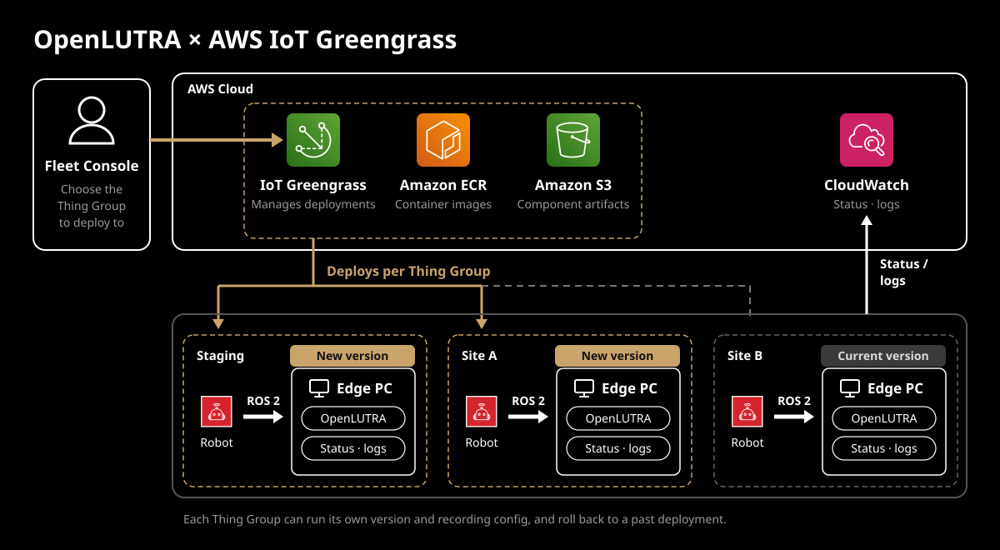

# OpenLUTRA on AWS IoT Greengrass

Deploys this repository's OpenLUTRA to edge PCs with Amazon ECR and AWS IoT Greengrass V2, and monitors them. The backend image is built from the repository's root `Dockerfile`; the frontend is built into static files from `frontend/` and served by nginx.

> [!NOTE]
> This is a sample implementation of deploying OpenLUTRA with Greengrass, not meant to be used in production as-is. Adapt the component name, region, recording config, monitoring thresholds, and so on to your environment.

## Architecture



See [docs/architecture.md](docs/architecture.md) for how it works.

All commands below run in `examples/greengrass/` (`cd examples/greengrass` first, or `make -C examples/greengrass ...`). Paths are relative to `examples/greengrass/`.

## Requirements

- Operator's PC: Docker (buildx), AWS CLI v2, Terraform 1.5 or later, jq, envsubst (gettext), git. [uv](https://docs.astral.sh/uv/) to use Fleet Console
- Edge PC: Ubuntu (amd64). `setup.sh` installs Docker, Java, and the rest
- An AWS account (uses ECR, S3, IAM, IoT Core, Greengrass V2, CloudWatch)

## Costs and caveats

- The Status component sends CloudWatch custom metrics (`OpenLUTRA` namespace) per device. The number of metrics grows with the number of devices, and Fleet Console also calls `GetMetricData` while it is open, so check the pricing when you have many devices. CloudWatch Logs sent by LogManager are also billed by the amount stored.
- Fleet Console has no authentication. It listens only on `localhost`; do not expose it.
- `provisioned/`, written by device registration, contains private keys. Delete them from Fleet Console once handed to the device.

## Layout

| Path | Contents |
|---|---|
| `docker/` | Static serving image for the frontend (nginx) |
| `greengrass/` | Recipe and artifacts of the OpenLUTRA component (`compose.yml`, the Fast DDS config `fastdds.xml`, the sample recording config `config/example.yaml`), release scripts |
| `greengrass/status/` | The Status component, which sends monitoring metrics to CloudWatch |
| `device/` | Core device registration (run on the operator's PC) and setup (run on the edge PC) |
| `infra/` | AWS infrastructure (Terraform) |
| `console/` | Fleet Console: releases, deployments, and device status (runs locally) |

## AWS authentication

The make targets (`push` / `release` / `deploy` / `status` / `provision` / `console`) work with either of the following. When both are present, aws-vault is used.

- **aws-vault**: Pass a profile, as in `make deploy ... AWS_VAULT_PROFILE=<profile>`, and the command runs under `aws-vault exec` (`make console` with `--server`). Running `aws-vault exec <profile> -- make ...` is the same.
- **IAM user access keys**: Copy `.env.example` to `.env` and write the keys. Running `make deploy ...` and so on without `AWS_VAULT_PROFILE` uses these keys. `.env` goes into neither git nor the Docker images.

The scripts read the ECR URL, artifact bucket, IoT Policy, and Role Alias from `terraform output`. The Terraform state lives only on the PC that ran `terraform apply` (locally in `infra/`, git-ignored), so on other PCs write those values (`ECR_REGISTRY` and so on; see `.env.example`) in `.env`. Those PCs do not need Terraform either. Environment variables are used first, then `.env`, then `terraform output`.

Put IAM users in the group from `terraform output operator_group` (it has only the permissions needed for releases, deployments, device registration, and Fleet Console). Create the users and access keys in the AWS console (so the keys are not left in the Terraform state). The keys do not expire, so rotate them periodically. The group's permissions are not enough for the infrastructure's `terraform apply`. Run it with administrator credentials.

## Create the infrastructure

```shell
cd infra
terraform init
aws-vault exec <profile> -- terraform apply
```

## Release

```shell
# 1. Build the images and push them to ECR (only when the images' sources changed)
make push AWS_VAULT_PROFILE=<profile>

# 2. Create a component version
make release COMPONENT_VERSION=0.2.1 AWS_VAULT_PROFILE=<profile>

# 3. Deploy to a Thing Group (specify the recording config file)
make deploy COMPONENT_VERSION=0.2.1 THING_GROUP=<group> RECORDING_CONFIG=greengrass/config/example.yaml AWS_VAULT_PROFILE=<profile>
```

- The backend image is built from the root `Dockerfile` and the frontend image from `docker/frontend.Dockerfile`, both with the repository root as the build context (the frontend's is filtered by `docker/frontend.Dockerfile.dockerignore`).
- The image tag (`IMAGE_TAG`) is `git describe --tags` of the last commit that changed what goes into the images (the root `Dockerfile`, `.dockerignore`, `.env.example`, `backend/`, `config/`, `frontend/`, `examples/greengrass/docker/`). A commit that touches only the rest of `examples/greengrass/` needs no new push. ECR tags cannot be overwritten, so a tag can be pushed only once. `make image-tag` prints it.
- Images are built for `linux/amd64` by default. Change it with `PLATFORM=...`.
- The component name defaults to `com.example.OpenLutra`. Write a name in your own domain and the recipe publisher in `COMPONENT_NAME` / `COMPONENT_PUBLISHER` in `.env` (see `.env.example`). Changing the name makes a different component; version and deployment history do not carry over.
- Specify `COMPONENT_VERSION` every time. Only the `MAJOR.MINOR.PATCH` form is allowed (versions with a hyphen cannot be resolved on the device). It is independent of `IMAGE_TAG`.
- The recording config is sent with its contents on every deployment (`RECORDING_CONFIG`; it stops if omitted). Alternatively, pass JSON in `CONFIGURATION` to deploy with the OpenLUTRA component's configuration overridden directly.
- Specify the target `THING_GROUP` every time (it stops if omitted). A default group would risk deploying to an unintended site.
- `make status` shows the version each device runs and the status of the latest deployment. Omitting `THING_GROUP` shows all groups.

### From Fleet Console

The same steps can be run from Fleet Console in the browser. It needs [uv](https://docs.astral.sh/uv/).

```shell
make console AWS_VAULT_PROFILE=<profile>
# open http://localhost:8800
```

- For each Thing Group, it shows the current deployment, each device's status (OK / Updating / Warning / Error), and the deployment history.
- The release and deploy buttons run `make push` / `make release` / `make deploy` above and show their output. Only one runs at a time.
- It can also create Thing Groups and register devices (same as `make provision` below). The registration data can be downloaded as a zip together with `setup.sh`.
- Before deploying, it shows the diff from the current deployment and asks you to type the Thing Group name to confirm. Choosing a past deployment from the history redeploys it with the same version and config (rollback).
- Started with aws-vault, it runs under `aws-vault exec --server`, so credentials are refreshed automatically while it is open. To start it with the keys in `.env`, omit `AWS_VAULT_PROFILE`.

## Add a device

Devices hold no AWS credentials. Registration is done on the operator's PC, and only the certificate is handed to the device.

```shell
# 1. Operator's PC: create the Thing and certificate and write them to provisioned/<thing-name>/
make provision THING_NAME=<thing-name> THING_GROUP=<group> AWS_VAULT_PROFILE=<profile>

# 2. Copy the written directory to the edge PC securely (it contains the private key)

# 3. Edge PC (Ubuntu): install and start Docker, Java, and the nucleus
sudo bash device/setup.sh <bundle-dir>

# 4. Once it works, delete the private key (provisioned/<thing-name>/private.pem.key) from the operator's PC
```

`provisioned/<thing-name>/metadata.json` records which Thing and group a certificate was issued for, and when. Keep it as the issue record even after deleting the private key (Fleet Console lists them under "Secrets").

If `setup.sh` fails partway, remove what `setup.sh` installed (the Greengrass service, `/greengrass`, `ggc_user`, the OpenLUTRA containers) with `sudo bash device/cleanup.sh`, then run `setup.sh` again. Recording data, Docker, and Java are kept (`--data` also removes the recording data, `--images` also removes the OpenLUTRA images). The zip downloaded from Fleet Console contains `setup.sh`, `cleanup.sh`, and a `README.md` with the steps on the edge PC (`device/bundle-README.md` with the device name and so on filled in).

The device is added to the Thing Group given in `THING_GROUP`, so the group's current deployment reaches it automatically.

## Monitor

Each device's Status component sends free disk space, whether it is recording, the loss rate, and more to CloudWatch metrics every 60 seconds. LogManager sends logs to CloudWatch Logs. See [docs/architecture.md](docs/architecture.md#monitoring) for details.

- Fleet Console shows a device as "Error" when its status has not arrived for 10 minutes or more, OpenLUTRA does not respond, or the component is not running; and as "Warning" when free disk space is below 5% or it will be full within 3 days, the loss rate exceeds 2%, a deployment failed, or it stays on a version different from the deployment without updating. CloudWatch alarms and notifications are not included.
- The Status component and LogManager are created and deployed together with OpenLUTRA by `make release` / `make deploy`.

## Change the recording config

- Deploy: put a YAML file in `greengrass/config/` (copy `example.yaml` and adapt it to the actual robot), then deploy it with `make deploy THING_GROUP=<group> RECORDING_CONFIG=<that file>` or from Fleet Console. The contents travel in the deployment configuration to the device, so no new version is needed. Fleet Console's confirmation screen shows the diff from the current config. YAML files other than `example.yaml` are git-ignored; change `.gitignore` to manage them in git.
- Try it on one device: create a test Thing Group, move the device into it, and deploy to that group.
